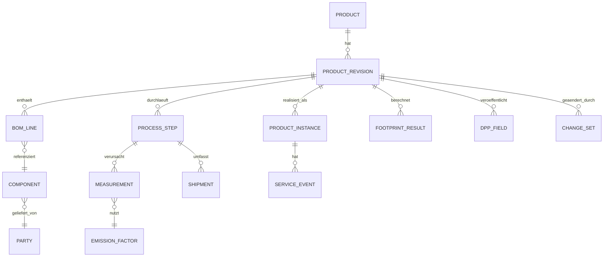

# Dataciders DPP-Demonstrator — Technische Gesamtspezifikation

**Status:** Umsetzungsgrundlage für IT/UX · **Version:** 1.0 · **Stand:** 23.10.2026  
**Leitprinzip:** **Ein Produkt, ein verknüpfter Datenbestand, fünf Sichten. Keine Mock-Daten im Demonstrator.**

## 1. Ziel, Umfang und Bildreferenzen

Die Anwendung macht Produktinformationen aus **real angebundenen Unternehmenssystemen** über den gesamten Lebenszyklus hinweg nutzbar. Produktdetails, Teile, Materialien, Emissionen, Compliance, Lieferantenbeiträge und Aftersales-Ereignisse sind **referenzierte, versionierte Teile desselben Produkt-Zusammenhangs** — keine fünf unabhängig befüllten Dashboards.

| Bereich | Route (Vorschlag) | Inhalt | Umsetzung |
| --- | --- | --- | --- |
| Einstieg / Produktwahl | Produktkatalog als Einstiegszustand bzw. Auswahl-Overlay | Produktgruppe → konkretes Produkt / Batterie wählen | **Keine sechste Fachseite**; Gestaltung nach [`assets/01_showroom.png`](assets/01_showroom.png) |
| **1. OEM** | `/products/:productId/oem` | Produktcockpit, Wertschöpfung, Engineering, Design-Änderungen, PCF, DPP | [`pages/01_OEM.md`](pages/01_OEM.md) · [Bild](assets/02_oem.png) |
| **2. Endkunde** | `/products/:productId/customer` | Öffentlich zulässiger Batteriepass, QR, Nachhaltigkeit, Reparatur | [`pages/02_ENDKUNDE.md`](pages/02_ENDKUNDE.md) · [Bild](assets/03_endkunde.png) |
| **3. Zulieferer** | `/products/:productId/supplier` | Lieferantennetzwerk, eigene Beiträge, Nachweise, Transporte | [`pages/03_ZULIEFERER.md`](pages/03_ZULIEFERER.md) · [Bild](assets/04_zulieferer.png) |
| **4. CO₂ & Scopes** | `/products/:productId/footprint` | Unternehmens-Scopes, PCF, Daten-Röntgenblick, semantische Aggregation | [`pages/04_CO2_SCOPES_DATENFLUSS.md`](pages/04_CO2_SCOPES_DATENFLUSS.md) · [Bild](assets/05_co2_scopes.png) |
| **5. Aftersales** | `/products/:productId/aftersales` | Field Feedback, Service, Ersatzteile, Reparatur, Rückführung | [`pages/05_AFTERSALES.md`](pages/05_AFTERSALES.md) · [Bild](assets/06_aftersales.png) |

**Verbindliche Bildinterpretation:** Screenshots sind **visuelle und funktionale Referenzen**, keine verlässlichen Stammdaten. Beispielzahlen, Status, Zeitpunkte, Stoffbezeichnungen oder Auswirkungsprozentsätze darin sind **nicht fest zu programmieren**. Wo die Bilder unterschiedliche Entwicklungsstände desselben Beispiels zeigen (z. B. Zellchemie im Szenario versus Zuliefererprodukt), hat stets der aktuelle, versionierte Live-Datenbestand Vorrang. Die Katalogaufnahme weiterer Produktgruppen bedeutet nicht, dass hierfür bereits reale Daten/Regelwerke vorliegen.

### Abgrenzung für diesen Lieferumfang

Sechs Markdown-Dateien insgesamt: diese Übersicht plus die fünf obigen Seitenspezifikationen. Die sechs Bilder liegen im Ordner `assets/`. Der Produktgruppen-Showroom ist ein auswählbarer **Einstiegszustand** in der gemeinsamen Shell; keine separate Seitenspezifikation oder sechste Fachroute. Auf jeder Fachseite kann zum Katalog zurückgewechselt werden.

## 1a. Technische Gesamtentscheidung für das Projekt

**Entscheidung:** Für den Showroom wird **keine echte 3D-Raumnavigation** umgesetzt. Stattdessen wird ein **2.5D / Pseudo-3D-Showroom** realisiert, der den Eindruck eines räumlichen, perspektivischen Produkt- und Perspektivenshowrooms erzeugt, ohne die Komplexität, Performance- und Pflegekosten einer echten 3D-Kamerawelt zu verursachen.

### Warum 2.5D und nicht echtes 3D?

- **Performance und Green IT:** echte 3D-Renderings sind in Web-Umgebungen deutlich rechenintensiver, häufiger auf Mobilgeräten langsamer und energetisch teurer als eine klare 2D-/2.5D-Ansicht.
- **Bessere UX für DPP- und Daten-Workflows:** Die fachlichen Inhalte sind produkt- und datenorientiert, nicht primär Raum- oder Spiel-Interaktion. Die Anwendung muss datenorientiert, verständlich und sicher sein, nicht „3D-Spiel“.
- **Einfache Wartbarkeit:** Die Produkt- und Perspektivseiten sollen in einer gemeinsamen App-Shell laufen. 2.5D lässt sich mit CSS-Transformationen, Layering, Schatten, Perspektive und Animationen elegant und robust umsetzen.
- **Weniger technische Schulden:** 3D-Engines erhöhen die Komplexität für API-Anbindung, Accessibility, Responsive Design und Testbarkeit.

**Konsequenz:** Der Showroom ist visuell räumlich inszeniert, aber fachlich und technisch als klassische Web-UI gestaltet.

### Empfohlener Tech-Stack (für das gesamte Projekt)

**Frontend**
- React + TypeScript
- Vite als Toolchain
- HTML/CSS als Basis der Darstellung
- CSS-Transformen, Perspektive, Layering, Deep-Shadow, Hover-/Focus-Effekte für den 2.5D-Showroom
- Optional: GSAP oder Framer Motion für gezielte Animationen

**Backend**
- ASP.NET Core Web API mit C#
- PostgreSQL als primäre Datenbank
- EF Core für Datenzugriff und Modellierung
- OIDC / Keycloak / Azure AD für Authentifizierung und Berechtigungen

**Architekturprinzipien**
- UI-First: erst die Oberfläche, dann die Datenfelder
- gemeinsame App-Shell mit fünf fachlichen Perspektiven
- Völlig getrennte Sicht von Präsentation und Masterdaten
- Serverseitige Prüfung von Rechten, Sichtbarkeit und Datenquelle
- keine Mock-Daten als echte Produktdaten

### Warum diese Entscheidung für das Gesamtprojekt?

- **React + TypeScript** ist gut geeignet für wiederverwendbare UI-Komponenten, komplexe State-Modelle und saubere Datenbindung.
- **HTML/CSS** ist nicht nur für Prototyping geeignet, sondern die Grundlage für die 2.5D-Inszenierung und die App-UI-Elemente.
- **ASP.NET Core + C#** passt besonders gut zu einer industriellen DPP-/Produkt-/Lieferketten-Anwendung mit Rollen, Rechteprüfungen, Revisionskonzepten und strengem Datenmodell.
- **PostgreSQL** eignet sich gut für verknüpfte Produkt-, BOM-, Lieferanten-, Emissions- und Nachweisdaten.
- **Green IT**: Das 2.5D-Konzept ist deutlich energieeffizienter als ein echter 3D-Raum. Die Architektur vermeidet unnötige Rechenlast und reduziert Browser-/Server-Overhead.

### Green-IT-Grundlagen für dieses Projekt

Die Projektentscheidungen folgen den wichtigsten Green-IT-Prinzipien:

- geringe Rendering-Last im Frontend
- keine unnötige 3D-Engine-Komplexität
- kleine, effiziente Bundles und geringe JS-Last
- nur die tatsächlich benötigten Daten laden
- keine redundanten, mehrfach gepflegten Datenmodelle
- effiziente API- und DB-Abfragen
- sauberes Caching und Auswahl der richtigen Datenmengen
- langlebige Architektur statt technischer Überkomplexität
- nachhaltiges Hosting mit sauberem Energie-/Cloud-Setup, sofern verfügbar

### Implementierungsreihenfolge

1. **Showroom/UI** als 2.5D-Produktwahl und Einstieg realisieren.
2. **Gemeinsame App-Shell** (Header, Sidebar, Perspektiven- und Produktkontext) bauen.
3. **Fünf Fachseiten als 2D-Ansichten** mit Platzhaltern und echten Layouts umsetzen.
4. **Datenmodelle und API-Contracts** definieren und einbinden.
5. **Datenfelder und Live-Verknüpfungen** zwischen den Seiten und den realen Quellen anlegen.
6. **Performance, Rechteprüfung, Datenqualität und Green-IT-Checks** abschließend validieren.

**Leitprinzip:** erst die Oberfläche mit klarer Informationsarchitektur, dann die verknüpfte Datenwelt. Dadurch bleiben die fachlichen Entscheidungen belastbar, leicht testbar und technisch sauber.

## 2. Wiederverwendete Anwendungsschale (OEM-Screenshot ist maßgeblich)

Die **Topbar und linke Sidebar aus `02_oem.png` sind gemeinsame, wiederverwendete Komponenten**. Auf allen fünf Inhaltsseiten bleiben Position, Maße, Navigation und Grundstil konsistent. Die abweichenden Navigationen/Header der anderen Referenzbilder dürfen **nicht** als parallele Header-/Sidebar-Implementierungen übernommen werden. Spezifische visuelle Darstellungen (z. B. dunkle CO₂-Grafik oder Aftersales-Showroom) werden **nur im Content-Bereich** realisiert.

```text
AppShell (einmalig)
├─ GlobalHeader (einmalig)
│  ├─ Dataciders-Logo + „Batterie-DPP Demonstrator“
│  ├─ ProductSwitcher / Zurück zum Showroom
│  ├─ PerspectiveSwitcher [OEM | Endkunde | Zulieferer]
│  └─ Suche / Benachrichtigungen / Session- und Benutzer-Menü
├─ GlobalSidebar (einmalig; OEM-Design)
│  └─ kontextabhängige Navigation und Abschnitts-Links
└─ RouteOutlet (wechselnder Content, genau fünf Fachseiten)
   ├─ OEMPage
   ├─ CustomerPage
   ├─ SupplierPage
   ├─ FootprintPage
   └─ AftersalesPage
```

| Globales Element | Verbindliches Verhalten |
| --- | --- |
| Logo & App-Titel | Stets sichtbar, gleicher Stil; Klick öffnet Produktwahl / Showroom. |
| Aktives Produkt | `productId`, Name, Revision und ggf. Serien-/Chargenbezug im gemeinsamen App-State; Wechsel lädt denselben Kontext in jeder Seite neu. |
| Perspektivenumschalter | **Frei anklickbar** zwischen OEM, Endkunde, Zulieferer; erhält `productId` und ggf. `serialId`; ändert Darstellungs- und Berechtigungskontext, **nicht** die Identität des Produkts. |
| Rechte | **Perspektive ≠ Berechtigung.** Nutzer dürfen Ansichten wechseln, sehen aber nur freigegebene Daten und können nur im Rahmen realer Rollen-/Objektrechte bearbeiten. API prüft Rechte erneut. |
| Sidebar | Gemeinsame Komponente; OEM-Stil mit Icons, Active State, Hover, Tastaturzugang. Menüpunkte können kontextuell Überschriften/Sprungmarken statt neue Seiten sein. Zusätzlich müssen die **fünf Fachseiten direkt erreichbar** sein (z. B. über „Ansichten“ oder einen gemeinsamen Seitenwähler). |
| Suche | Sucht ausschließlich nach für den Akteur sichtbaren Produkten, Teilen, DPP-Einträgen und Aftersales-Fällen; Ergebnisse referenzieren persistente IDs. |
| Notifications | Veränderungen, Regelverstöße, fehlende Quelldaten, Synchronisationsfehler und Fälle. |
| Persistenz | Aktive Ansicht, Produkt und Filter via URL/Query; Reload und Deep Links erhalten den Zustand (soweit berechtigt). |
| Responsivität | Desktop-first; Sidebar auf schmalen Displays einklappbar, Header und Wechsel der Perspektiven bleiben zugänglich. |

**Sidebar-Zuordnung:** Die OEM-Referenz enthält „Übersicht“, „Produkt“, „Wertschöpfung“, „DPP-Daten“, „Analysen“, „Szenarien“, „Einstellungen“. Diese dürfen zur Bedienung als Abschnittsanker/Darstellungsaktionen wiederverwendet werden: Produkt/Wertschöpfung → OEM-Inhaltssektion; DPP-Daten → entsprechende Sektion in OEM bzw. öffentliche Ansicht; Analysen → CO₂-Seite; Szenarien → OEM-Änderungs-Panel; Einstellungen → globales Drawer. Die **fünf Hauptansichten** müssen unabhängig davon eindeutig erreichbar und im aktiven Zustand erkennbar sein; keine versteckten Sackgassen. „Aftersales“ ist eine zusätzliche fachliche Hauptansicht.

**Designsystem:** ein gemeinsamer Satz `AppShell`, `PageHero`, `MetricCard`, `StatusBadge`, `DataTable`, `LifecycleNode`, `EvidenceLink`, `EntityDrawer`, `ChangeDiff`, `SourceTrace`, `Loading/Empty/ErrorState`; Inhaltsseiten stellen diese Komponenten mit je eigener fachlicher Komposition zusammen. Gleiche Einheit, Herkunft, Statuslogik und UI-Semantik in jeder Sicht.

## 3. Zielarchitektur (Live-Integration statt Mocking)

```mermaid
flowchart LR
  subgraph ext[Reale Quellsysteme]
    ERP[ERP]
    PLM[PLM / PDM]
    MES[MES / Qualität]
    LCA[LCA / Emissionsfaktoren]
    SCM[Lieferanten / Nachweise]
    LOG[Logistik / TMS]
    BMS[BMS / IoT]
    CRM[Service / CRM]
  end
  ext --> CON[Connectoren / Webhooks / CDC / APIs]
  CON --> RAW[Quellreferenzen + unveränderte Nachweise]
  RAW --> CAN[Canonical Product Graph + Semantik / AAS-Mapping]
  CAN --> DEP[Abhängigkeitsgraph + deterministische Berechnung / Regelprüfung]
  DEP --> VIEW[Abfrage-API / rollen- & feldbezogene Projektionen]
  VIEW --> UI[AppShell + 5 Fachseiten]
  DEP --> EVT[Versionierte Änderungsereignisse]
  EVT --> UI
  UI --> CMD[Autorisierte Änderungsbefehle]
  CMD --> WR[Source-of-Truth-Writeback / validierte Commands]
  WR --> CON
```



### Pflichtbausteine

1. **Integrationsschicht:** Reale produktive oder explizit freigegebene Integrationsumgebungen. Adapter für REST/GraphQL, Event/Webhook, CDC oder standardisierte Formate, abhängig vom Quellsystem. API-Credentials serverseitig. Je Attribut definierter **System of Record**; nicht das UI.
2. **Kanonsches Produktmodell / Knowledge Graph:** dauerhafte IDs, BOM-/Prozess-/Akteurs-/Chargenbeziehungen, Herkunft und Gültigkeit. Datensätze werden verknüpft, nicht als fünf redundante Kopien geschrieben.
3. **Semantik:** einheitliche Bezeichner, Einheiten, Maßeinheitenumrechnung, Klassifikationen, Zeit-/Standortbezug, Methodik. **AAS/Submodelle** bei vorhandener Integration als Austausch-/Strukturmodell anbinden; **nicht** bei jeder Ansicht AAS-Kopien anlegen. Eigenständige Systemsicht/Mapping bleibt fachlich im CO₂-Daten-Röntgenblick.
4. **Berechnungs- & Regelebene:** versionierte, nachvollziehbare Formeln, Faktoren, Gültigkeitszeiträume, Allokations- und Cut-off-Regeln, Herkunft. Abhängige Kennzahlen inkrementell neu berechnen; unveränderte Felder beibehalten. Regulatorische Pflichten aus versioniertem, gepflegtem Rule Set; **keine Ableitung von Rechtsstatus aus Screenshot-Labels**.
5. **Read Models / Queries:** materialisierte oder berechnete Projektionen auf Basis derselben Entities für OEM, Öffentlichkeit, Lieferanten, CO₂ und Aftersales; unterschiedliche Sichtbarkeit, **keine eigenständigen Datensilos**.
6. **Update- und Echtzeitkanal:** Quell-Events oder Abgleich → idempotentes Mapping → Neuberechnung → Versionierung → WebSocket/SSE Invalidierung der betroffenen Views → gezieltes Nachladen. Bei Nutzer-Änderungen API-Command, serverseitige Prüfung, Writeback und klarer Synchronisierungsstatus.
7. **Audit & Observability:** nachvollziehbare Änderungsprotokolle, Korrelations-/Event-IDs, Connector-Health, letzte erfolgreiche Aktualisierung, fehlende Pflichtfelder, Regeln, Rechenversionen und Fehlerzustände.

### „Live“ und „sofort“ — technisch präzise

- **Keine generierten Mock-Datensätze oder hartkodierten KPI-Werte** in der benutzerseitigen Anwendung. Nicht angebundene Daten: `nicht verfügbar`, mit Herkunfts-/Verfügbarkeitsgrund, statt erfundener Demo-Werte.
- **Sofortige Konsistenz innerhalb des Demonstrators:** Sobald ein Änderungsbefehl als gültige Revision akzeptiert wurde, sind **alle davon abhängigen Projektionen** auf derselben Revision oder vorübergehend sichtbar `wird aktualisiert`; kein länger stehender scheinbar aktueller Altwert.
- Bei **externen Systemen** hängen Bestätigung und Rückschreiben von deren APIs ab. `ausstehend`, `übernommen`, `fehlgeschlagen` und ggf. `Konflikt` sichtbar führen; **kein Erfolg suggerieren**, solange das führende System nicht bestätigt hat. Für kritische Werte erst nach Bestätigung als `aktuell` deklarieren; vorberechnete Vorschau klar als `vorläufig` markieren.
- Direkte Änderungen im UI nur für Felder, die über autorisierte, transaktional abgesicherte Command-/Writeback-Pfade verfügen. Für read-only Quellen: Änderungsantrag / Sprung ins führende System, nicht lokaler Schein-Edit.
- Testdaten/Fixtures dürfen in isolierten automatisierten Tests genutzt werden, **nicht als vermeintlich echte Live-Quellen** der Demo.

## 4. Gemeinsames verknüpftes Datenmodell

**Jedes Objekt**: `id`, `sourceSystem`, `sourceRecordId`, `revision`, `validFrom`, `validTo?`, `observedAt`, `lastSyncedAt`, `classification`, `accessPolicy`, `dataQuality`, `provenance`. Numerische Attribute zusätzlich `value`, `unit`, `basis`, `method`, `uncertainty?`; kein impliziter Vergleich ungleicher Systemgrenzen.

| Entity | Minimalfelder / Beziehungen | Führende Quelle (Beispiel, verbindlich zu konfigurieren) |
| --- | --- | --- |
| `Product` / `ProductRevision` | Produkt-ID, Typ, Nennwerte, Status, BOM-Revision, Gültigkeit; `hasComponent` | PLM/PDM |
| `ProductInstance` / `Batch` | Serien-/Chargen-ID, Produktrevision, Fertigung, Servicekontext, Sichtbarkeit | ERP/MES/Serialisierung |
| `Component` / `Material` | Artikel-ID, Materialtyp, **Masse**, chemische Zusammensetzung falls freigegeben, Gültigkeit | PLM/PDM + Lieferant |
| `BOMLine` | Eltern-/Kind-ID, Stückzahl, Einheit, Ausschussfaktor, Version, optional Zuweisung zu Charge | PLM/PDM |
| `Party` / `Facility` | OEM, Lieferant, Werk, Eigentümer, Standort, zugeordnete Organisationsgrenze | ERP/SCM |
| `ProcessStep` / `LifecycleStage` | Werk, Aktivität, Inputs/Outputs, Zeit, Vor-/Nachfolger, Produktzuordnung | MES/PLM/Logistik |
| `Shipment` | Von/nach, Charge, Masse, Distanz, Verkehrsträger, Carrier, Belastungsfaktor | TMS/ERP |
| `Measurement` / `EmissionFactor` | Menge, Einheit, Zeit, Ort, Bilanzgrenze, Methoden-/Faktorversion | ERP/MES/BMS/LCA |
| `FootprintResult` | Produkt-/Revisions-ID, funktionelle Einheit, Lebenszyklusphase, Methode, Scope-Klassifikation nach Blickwinkel, Ergebnis, Qualität | Berechnungsdienst (aus Quellen) |
| `DPPField` / `DisclosurePolicy` | semantischer Schlüssel, Quelle, Sichtbarkeitsklasse, Recht/Regelversion | Semantic Layer + Regeln |
| `Evidence` | Typ, Dokument-ID, Prüfer, Status, Gültigkeit, Hash, Quelle, Bezug zu Produkt/Charge | QMS/DMS/SCM |
| `ServiceEvent` / `Telemetry` | Serien-ID, Zeit, Eventart, Parameter, Fehler-/Servicecode, Berechtigung | CRM/BMS/IoT |
| `SparePartCompatibility` | Teil-ID, Produkt-/Revision-/Serienrange, Zulässigkeit, Beleg/Regel | PLM/Servicekatalog |
| `ChangeSet` / `AuditEvent` | Before/After, Akteur, Begründung, Revision, Ereignis-ID, abhängige Berechnungen | Plattform-Audit |

**Kernbeziehungen:** `ProductRevision → BOMLine → Component/Material → Supplier/Facility`; `Product/Batch → ProcessStep → Shipment`; `Measurement + Factor + Allocations → FootprintResult → DPPField`; `ProductInstance → ServiceEvent / Telemetry / SparePartCompatibility`; `ChangeSet → affectedEntities → recalculatedResults`. Lieferantenbeitrag und OEM-Produkt hängen **an derselben BOM-/Chargenrelation**. Massen sind auf **Komponenten-/Revisionsebene** erfasst, OEM-Gesamtmassen **abgeleitet oder mit führender Gesamtmasse abgeglichen** (Konflikt kennzeichnen, nicht blind überschreiben).



**Keine redundante Truth:** Ein fachliches Attribut hat genau eine dokumentierte Masterquelle. UI-Projektionen/Cache dürfen vorhanden sein, müssen aber revisionierbar und automatisch invalidierbar sein. Der Produktpass ist eine **kuratierte, autorisierte Projektion** des Graphen, keine manuell gepflegte Parallel-Datenbank.

## 5. Verbindlicher Änderungsablauf — Beispiel Gewicht

Beispiel ohne fest vorgegebene Zahl: In PLM wird das Gewicht von **Komponente `C` in BOM-Revision `R`** geändert; das Produkt `P` enthält diese Komponente in Stückzahl `q`.

1. **Eingang:** PLM-Webhook/CDC oder autorisierter UI-Command mit `componentId`, `revision`, `before`, `after`, Maßeinheit, Akteur, Quellrevision; Optimistic Locking/ETag schützt vor konkurrierenden Updates.
2. **Validierung:** Schreibrecht, Masse `>= 0`, Einheitenkonversion, Gültigkeitszeitpunkt, betroffene BOM-Linien, Charge/Revision und zulässige Systemgrenzen ermitteln; Quellbestätigung abwarten.
3. **Diff:** `Δm_komponente = m_neu − m_alt`; je verbauter Linie `Δm_line = q × Δm_komponente` (ggf. nach eindeutig dokumentierter Ausschuss-/Bilanzlogik). Auswirkungen auf Gesamtproduktgewicht, Teilmengen, Verpackungs-/Transportzuordnung und Recyclingmassen nur berechnen, **wenn** die jeweiligen Modellbeziehungen existieren.
4. **Abhängigkeitsgraph:** Materialmenge, PCF-Beiträge aus material-/massenabhängigen Faktoren, gewichtsbasierten Transporten, ggf. Recycling-/EoL-Werte und DPP-Felder neu berechnen. Festes Fahrzeuggewicht, gemessene tatsächliche Betriebsemissionen, Garantie und Unternehmens-Scopes **nicht** pauschal verändern.
5. **Atomic publish:** betroffene Read Models auf konsistente neue Version überführen; Änderungs-Event und `impactSet` senden. Alle offenen fünf Seiten invalidieren **nur** abhängige Elemente und zeigen überall dieselbe Produktrevision.
6. **Nachvollziehbarkeit:** OEM zeigt Gewicht + Impact-Diff; Zulieferer zeigt seinen betroffenen Komponentenbeitrag (wenn dessen Eigentum), CO₂ die neue PCF-Allokation und Datenherkunft, Endkunde nur freigegebene Felder, Aftersales ggf. Reparatur-/Logistik-/Restwertdaten, **sofern eine belegbare Abhängigkeit besteht**.
7. **Fehlerfall:** Abhängigkeit nicht berechenbar → `unvollständig`/`Prüfung erforderlich`, nicht vorherige Zahl unmarkiert behalten; bei Writeback-Fehler keine irreversible lokale Phantomänderung.

**Berechnungsprinzipien:** Einheiten mit UCUM-/gleichwertig eindeutigem Einheitenmodell; pro Kennzahl deklarierte Bezugsgröße und Systemgrenze. Beispiel `PCF = Σ(Aktivitätsdaten × verifizierter Emissionsfaktor × gültige Allokation)` über dokumentierte Lebenszyklusphasen. **Unternehmens-Scopes 1–3 und Produkt-PCF sind verschiedene Bilanzierungen**; ein Zulieferer-„Scope 1“ ist aus OEM-Sicht nicht automatisch dessen Scope 1. Keine doppelte Addition über Unternehmensgrenzen und keine erfundenen Einsparquoten.

### Technische Events und Commands (schematisch, keine Demo-Daten)

```json
{
  "eventType": "product.dependencies.updated",
  "eventId": "<uuid>",
  "productId": "<persistent-product-id>",
  "productRevision": "<new-revision>",
  "sourceChangeId": "<plm-change-id>",
  "changedEntityIds": ["<component-id>"],
  "affectedFields": ["component.mass", "product.mass", "footprint.materialContribution"],
  "calculationStatus": "ready|pending|failed",
  "occurredAt": "<ISO-8601 UTC timestamp>"
}
```

```text
GET    /api/v1/products/:productId/context                 Produkt, Revision, Berechtigungen, Frische
GET    /api/v1/products/:productId/oem                     OEM-Projektion
GET    /api/v1/products/:productId/customer                öffentliche Projektion nach Policy
GET    /api/v1/products/:productId/supplier?partyId=...    eigener / autorisierter Zuliefererbeitrag
GET    /api/v1/products/:productId/footprint               Scopes, PCF, Data Lineage
GET    /api/v1/products/:productId/aftersales              Nutzungs-/Serviceprojektion
GET    /api/v1/entities/:id/lineage                        Herkunft, Formel, Quellen, Version
POST   /api/v1/commands/change                             autorisierter Änderungsbefehl + ExpectedRevision
GET    /api/v1/changes/:changeId                           Status des Writebacks + Recalculation
GET    /api/v1/evidence/:id                                autorisierter Dokumentenzugriff
SSE/WS /api/v1/stream?productId=...                        revisionsbasierte Invalidierung
```

API-Namen sind ein **Implementierungsvorschlag**, kein vorhandener Service. Jedes Response trägt `productRevision`, `calculatedAt`, `dataAsOf`, `quality/status`, `sourceRefs` (für Detailaufklappung) sowie eine serverseitig gefilterte Berechtigungsprojektion. Keine Quell-Credentials ins Frontend.

## 6. Interaktions- und Zustandskonzept

- **Produktwechsel:** über Header/Katalog; validiert Produktzugriff, führt zu gleicher Fachseite mit neuer `productId` bzw. Start in OEM; speichert keine Werte des alten Produkts.
- **Perspektivenwechsel:** global (OEM, Endkunde, Zulieferer); `productId` bleibt erhalten. Die fünf Fachseiten bleiben als Navigation verfügbar; inhaltliche Unteransichten werden bei Bedarf aus Berechtigungen abgeleitet. Bei unzulässigem Bereich begründeter Locked/Empty State.
- **Entitäten-Drill-down:** Klick auf Material, Werk, Lifecycle-Knoten, PCF-Beitrag oder Serviceevent öffnet **denselben** globalen `EntityDrawer` mit ID, Quellen, Verknüpfungen und Berechtigung; Rücknavigation behält Filter.
- **Änderung/What-if:** OEM-Panel trennt **tatsächlichen Schreibvorgang** (bestätigter Quell-Writeback) von **expliziter, nicht persistenter Vorschau**. Vorschau niemals als aktuelle DPP-Zahl verbreiten.
- **Konsistentes Laden:** Skeleton für Initial-Load; `keine Daten aus Quelle`, `keine Berechtigung`, `Sync ausstehend`, `Berechnung ausstehend`, `Qualitätsprüfung fehlgeschlagen` klar unterscheiden.
- **Methoden-/Datenhinweis:** jede KPI zeigt auf Klick: Definition, Einheit, Zeitraum, Bilanzgrenze, Ausgangsquellen, Berechnungsversion, letzte Aktualisierung. Prozentänderungen nur bei vorhandenem vergleichbarem Baseline-Datensatz.
- **Public Access:** QR zeigt auf öffentliche, signierte oder kontrolliert auflösbare Produkt-/Serienansicht; keine privaten IDs, Credentials, Lieferantenkonditionen oder BMS-Rohdaten leaken.

## 7. Sicherheits- und Qualitätsanforderungen

- **Identity:** bestehendes IAM/SSO, OIDC/OAuth2 oder projektspezifisch abgestimmte Authentifizierung; OAuth-Scopes und Mandant/Organisation; Gäste nur Public-Projektion.
- **Enforcement:** RBAC + ABAC auf **Server**, nach Rolle, Partei, Eigentümerschaft, Serien-/Produktbezug, Feldklasse und Nutzungszweck. Perspektivwechsel hebt Rechte nicht auf.
- **Schutz:** TLS, Secrets im Server-Vault, Audit, PII-Minimierung, sichere Nachweis-URLs, Upload-Malwareprüfung, Rate Limits, keine sensiblen Daten in Browser-Logs.
- **Data Contracts:** Schematypisierung, IDs, Pflichtfelder, Einheiten, Gültigkeit, Rechenmethode; externe Statuslabels in ein definiertes Statusmodell mappen (`complete`, `in_review`, `open`, `invalid`, `unknown`).
- **Resilience:** Retry mit Backoff, idempotente Events, Dead-Letter-Queue, Ausfallanzeige pro Connector, Wiederaufbau der Projektionen aus Quell-/Eventstand, Audit unveränderlich.
- **Performance-Zielwerte (zur Abnahme messbar, initialer Vorschlag):** Sichtwechsel ohne Full Reload; neue bestätigte Revision in offenen Clients **typischerweise ≤ 2 s nach interner Berechnung** sichtbar; serverseitige Abfrage p95 ≤ 1 s im Testdatensatz. Externe Quelllatenz und umfangreiche Rechenjobs gesondert messen und explizit signalisieren; keine fiktive harte SLA suggerieren.

## 8. Übergreifende Akzeptanzkriterien

- [ ] Header und Sidebar werden **einmal** implementiert und auf allen fünf Routen verwendet; OEM-Screenshot ist dafür Designreferenz.
- [ ] Alle fünf Fachseiten sind per gemeinsamer Navigation/URL erreichbar; Produkt-/Revisionskontext bleibt beim Wechsel erhalten.
- [ ] Ein Perspektivenwechsel ändert die Projektion, **nicht** die Produktidentität oder den gespeicherten Datenbestand.
- [ ] Rechteprüfung erfolgt serverseitig; eine frei auswählbare Perspektive ermöglicht **keinen** Zugriff auf vertrauliche Felder oder unerlaubte Schreiboperationen.
- [ ] Angezeigte fachliche Daten stammen nachvollziehbar aus **realen Integrationen**; ohne Quelle werden **keine** Zahlen, Zertifikate, Use-Case-Ereignisse oder Zeitpunkte erfunden.
- [ ] OEM-, Zulieferer-, CO₂-, Endkunden- und Aftersales-Felder referenzieren denselben `productId`-/Revisionsgraph; Unterschiede sind nur Projektion/Berechtigung/kontextuelle Daten.
- [ ] Eine in der Masterquelle bestätigte Gewichtsänderung propagiert **automatisch** an alle nachweislich abhängigen Werte, Diagramme und DPP-Felder; unverknüpfte Werte bleiben unverändert.
- [ ] Während der Neuberechnung sind veraltete KPI-Werte als `stale/pending` markiert; nach Fertigstellung sehen alle offenen Sichten dieselbe Revision.
- [ ] Fehlgeschlagene Schreib-/Syncvorgänge erzeugen keine als bestätigt angezeigten Änderungen; Konflikte sind für Nutzende erkennbar.
- [ ] PCF und Scope-Kennzahlen sind methodisch getrennt; Herkunft, Bilanzgrenze und Allokation sind abrufbar; doppelte Emissionszählung wird durch Tests verhindert.
- [ ] Berechtigter Klick auf Kennzahl/Dokument/Entität führt zu einer echten Datenquelle oder Detailprojektion, nicht zu einem inhaltslosen UI-Element.
- [ ] Mindestens ein End-to-End-Integrationstest durchläuft einen **wirklichen Test- oder freigegebenen Live-Connector** (PLM-Masse → Canonical Graph → PCF-Berechnung → 5 betroffene Projektionen → Audit/Event); isolierte Unit-Tests nutzen Fixtures separat.

## 9. Implementierungsreihenfolge / technische Definition of Done

1. **Integration und IDs:** führende Systeme je Attribut, Berechtigungen, lesbare/schreibbare Quellendpunkte, Produkt-ID ↔ BOM ↔ Chargen ↔ Lieferanten-IDs und Methoden-/Faktorquellen verbindlich mappen.
2. **Shell + Canonical Graph:** Shared Header/Sidebar, Routen und serverseitige Projektionen; ein repräsentatives **real angebundenes** Batterieprodukt Ende-zu-Ende verfügbar machen.
3. **Änderungsdurchstich:** Gewicht (und optional Zellchemie) inklusive Quellenbestätigung, Impactgraph, PCF-/DPP-Aktualisierung, Synchronisierungsstatus und Event-Push.
4. **Seiten:** OEM → Zulieferer → CO₂ → Endkunde → Aftersales auf denselben Services implementieren; Visualisierung nach Referenzbildern.
5. **Nachweise, Rechtesicherheit, Fehlerpfade:** Evidence, Datengüte, öffentliches Disclosure, Service-/IoT-Anbindungen, vollständiger Drill-down.

**Keine Freigabe**, solange KPI-Werte in Komponenten hardcodiert sind, Produktionsansichten unmarkierte Mockdaten anzeigen oder eine Änderung nur eine einzelne Seite aktualisiert.
